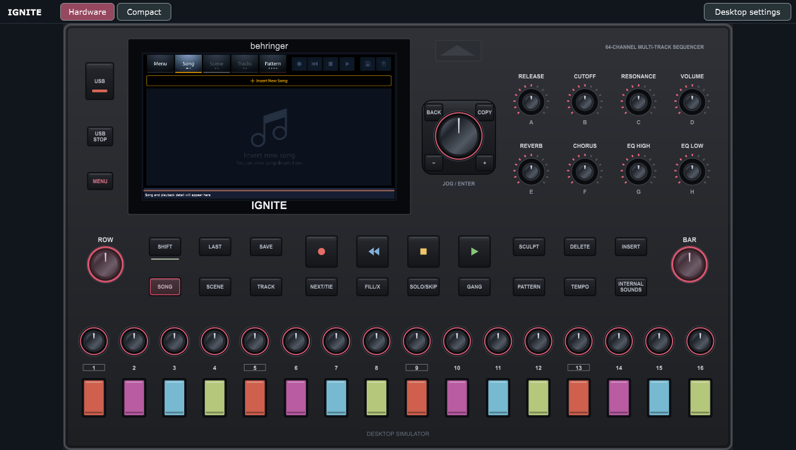

  

# Behringer IGNITE (BE 0716-AAF)

**Community Windows release:** [Downloads](https://github.com/chillbeast/0716-AAF/releases) · [User manual](docs/manual/USER_MANUAL.md) · [Printable PDF](docs/manual/USER_MANUAL.pdf) · [Release notes](RELEASE_NOTES.md)

Extract the Windows package and run `Ignite.exe`, then choose your own SF2 in **DESKTOP SETTINGS → SoundFonts**. The package includes the manual as PDF and self-contained HTML, plus corresponding source. This fork's desktop work is on `desktop-build`; `main` preserves the upstream baseline.

> **Local desktop-build branch:** Windows build and interactive hardware simulator bring-up are documented in [Build and run](docs/BUILD_WINDOWS.md), [capability map](docs/CAPABILITIES.md), [simulator guide](docs/manual/USER_MANUAL.md), and [development handoff](docs/DEVELOPMENT.md). This is a community development build, not an official firmware release.

The Windows simulator starts with a large touchscreen in **Compact** layout; the toolbar switches to the vector **Hardware** faceplate and remembers your choice. Both layouts use the same controls and live firmware screen. It also includes audio/device settings, MIDI routing, a bank-aware SoundFont browser with preview, step/live MIDI recording repairs and project backup ZIP export/restore. See [desktop features](docs/DESKTOP_FEATURES.md). Build and verify with `scripts/build-windows.ps1 -DebugBuild -Package`.

> There is a Creator in every human being. Our mission is to empower those who have not and cannot.

Source code for the Behringer IGNITE 64-channel multi-track sequencer.

  

## Key features

- 64-channel multi-track sequencer with a song, scene, track and pattern structure
- Patterns of up to 16 bars with 16 steps per bar, scenes of up to 200 bars, 96 PPQN timing
- Real-time recording, undo, fill, solo/skip, gang and sculpt functions
- Transpose control and up to 10 user-defined scales
- Internal General MIDI sound engine
- 5 MIDI DIN in/out pairs, USB MIDI, and USB host MIDI for up to 5 devices
- MIDI clock sync, MIDI Machine Control and remote control
- 8 CV and 8 Gate jacks with calibration, plus sync in/out
- Wi-Fi connectivity

## Release status

This repository contains the IGNITE application, its audio engine and hardware protocol, and the
Buildroot tree for the Linux image. Material that could not be redistributed was removed, so some
parts need your own replacements before they build (see the README in each folder). There is no
official firmware release here yet.

## Front panel

- Touchscreen
- 16 RGB step pads, each with its own encoder
- 8 assignable knobs (A–H) and a jog wheel
- ROW and BAR encoders
- Transport, song/scene/track/pattern, and edit buttons
- USB-A port (5 V, 1 A) with a USB STOP button

## Connections

  

| Rear panel |
|---|
| Power switch, 12 V DC input (2000 mA) |
| USB-C |
| 5 × MIDI IN / OUT (5-pin DIN) |
| 8 × CV, 8 × Gate |
| Sync in and out |
| Line / headphone output |

## Repository

| Folder | Contents | License |
|---|---|---|
| [`Source/Application/`](Source/Application) | Application (built on JUCE) | AGPL-3.0-or-later |
| [`AudIO/`](AudIO) | Audio engine library | AGPL-3.0-or-later |
| [`ComProtocol/`](ComProtocol) | Hardware communication protocol | AGPL-3.0-or-later |
| [`Linux/`](Linux) | Buildroot Linux image | GPL-2.0 (Buildroot) |

The root [`LICENSE`](LICENSE) is the AGPL-3.0 text that covers the Music Tribe code (Application, AudIO,
ComProtocol). Third-party components keep their original licenses. See the README in each folder.

## Community

- **Chat with us:** [Discord](https://discord.gg/gS6qtuShvw)
- **Contribute:** fork the repository and open a pull request. No membership needed. Sign off commits
  with `git commit -s`. See the
  [contributing guide](https://github.com/MusicTribeOpenSource/.github/blob/main/CONTRIBUTING.md) and
  [code of conduct](https://github.com/MusicTribeOpenSource/.github/blob/main/CODE_OF_CONDUCT.md).
- **Report a security problem** privately: [Report a vulnerability](https://github.com/MusicTribeOpenSource/0716-AAF/security/advisories/new).
  Do not post vulnerabilities or credentials in public issues. See [SECURITY.md](SECURITY.md).

---

Behringer is a brand of MUSIC Tribe. The Behringer name and logo, and the IGNITE name and logo, are
trademarks and are not covered by the software licenses in this repository. Neither are the product
images in `docs/images/`. See the
[trademark policy](https://github.com/MusicTribeOpenSource/.github/blob/main/TRADEMARKS.md).

Copyright (c) MUSIC Tribe.

Desktop reliability repairs and repeatable workflow tests: [audit notes](docs/AUDIT_FIXES.md).
