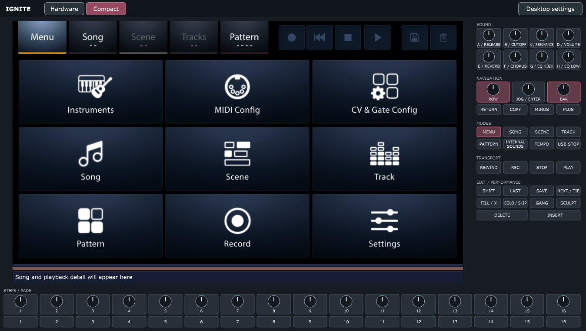
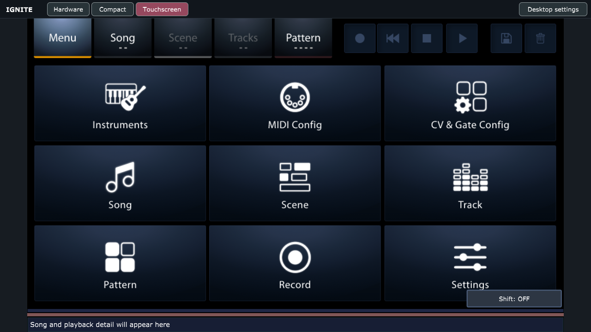
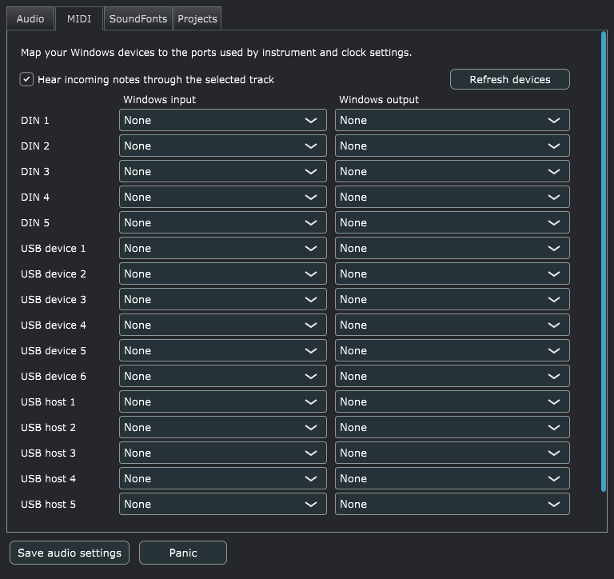
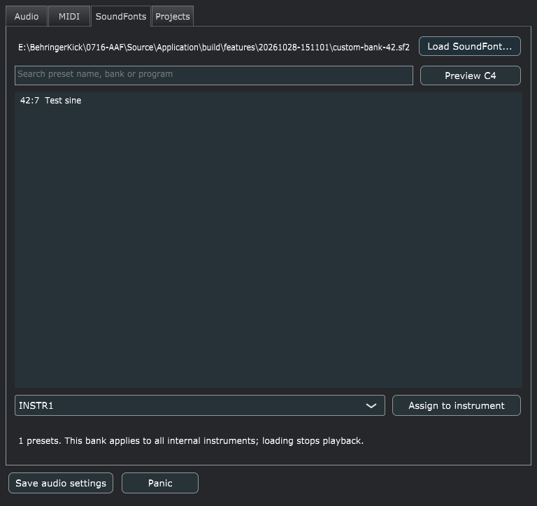
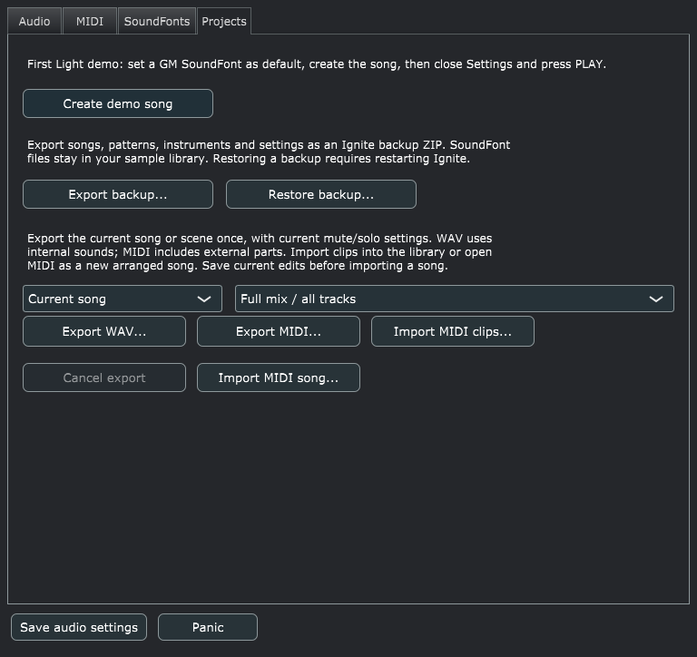

# Windows desktop features

Open **Desktop settings** in the top toolbar, or press **Ctrl+,**. The firmware touchscreen and its normal editing controls remain available alongside these Windows controls.

## Monitor layouts

The **Hardware / Compact / Touchscreen** toolbar switches between a large touchscreen with closely spaced controls and the SVG hardware faceplate. Compact is the default; your choice is saved as `PanelLayout` in `desktop.json`. Touchscreen hides all 69 hardware controls and fits the live display to the window, preserving its aspect ratio. The small mode/settings toolbar remains available. Keyboard shortcuts and MIDI/remote mappings keep working; switching layouts preserves the session and latched SHIFT state. The initial window fits the monitor work area, and Compact keeps the touchscreen's original aspect ratio when resized.



Use `Ignite.exe --compact` or `--hardware` for a temporary launch override. The source launcher accepts `scripts/run-ignite.ps1 -Layout Compact` or `-Layout Hardware`. These overrides leave the saved choice alone. Use `--touchscreen` or `-Layout Touchscreen` for the third mode. All three modes resize and remember toolbar selections.



## Audio

The Audio tab selects a Windows output, sample rate and buffer size. **Save audio settings** remembers the selection for the next launch. The synth runs at 48 kHz; the output adapter converts to the device rate. Play and MIDI monitoring open the output; stopping transport or finishing a preset preview can close it. **Panic** clears sounding internal notes.

## MIDI routing and recording



The MIDI tab maps Windows device names to the firmware's five DIN, six USB-device and five USB-host logical ports. Each row has independent input and output choices. Routes and the selected-track monitoring option are saved automatically. Use **Refresh devices** after connecting a controller, then choose its input. Outputs start at **None** to avoid unwanted routing to the Windows software synth.

These are software routes to Windows MIDI devices; selecting a DIN row does not create a physical DIN connector. Multiple logical rows may use one device. If startup reports a missing device, reconnect it, refresh the list and select the route again.

Assign the matching input port and channel to a track's receive instrument, and assign an output instrument with internal sound enabled to hear the selected track. The firmware displays channels 1–16 and stores them as 0–15. Start Record while stopped for step entry. For live recording, start playback, enable recording on the intended track, then start Record. Stop Record commits pending notes before saving.

The automated tests inject MIDI into the same router used by device callbacks. They check all 16 logical input/output IDs, channel filtering, step entry, live note velocity/duration, saving and reopening. No MIDI input devices were available during this pass, so physical controller input, Windows driver behavior, external clock timing and external hardware output remain unverified.

Internal synthesis now responds to sustain, pitch bend/RPN range, volume/expression, bank/program, modulation and pressure. Modulation and pressure follow the SoundFont's standard defaults and custom modulators. All Notes Off honors sustain; All Sound Off clears the track voices/effects. Panic permits subsequent notes without reloading the bank. Instrument/preset modulators, global/local override and default-modulator replacement are supported.

## Saving and editor fixes

Closing with pending edits offers Save, Discard and Cancel. Save All writes every loaded pattern/instrument plus the active song and firmware settings, preserving song-scoped settings. Failed writes keep pending changes and stop close/backup export. Settings use atomic file replacement; the complete save is still several independent file operations.

In Pattern view, Ctrl+Insert inserts a blank step and shifts later notes across bars, with undo and a 256-step limit. Gang velocity selection, signed Sculpt modes, pitch-map changes, MIDI/Sculpt settings undo, scale snapping and fill release have regression coverage. Other view-specific hardware key behavior remains available.

## SoundFonts



Choose **Browse SF2...** to open a bank from your sample library. The chooser starts at `D:\Old Samples` on this machine. Browsing leaves assignments intact; select a preset, choose an instrument and press **Assign SF2 + preset** to save that file and program for the instrument. Different instruments can play different SF2 files simultaneously. Sample data is shared by path, with independent track voices and effects.

The browser lists actual preset names and zero-based **bank:program** numbers, including non-GM banks. Search, use **Preview C4**, or double-click a row. Preview uses the browsed bank independently of the default. Create instruments in the firmware UI first. The Assigned line displays the instrument's bank path.

**Set as default SF2** saves the browsed file as the startup default, retaining explicit instrument assignments. **Use default SF2** returns the selected instrument to the default, preserving a matching preset or choosing the first available preset. Assigning a bank or changing the default stops playback. Missing assigned files stay silent without substituting another bank; other instruments continue working. Backups retain paths/programs, with SF2 samples kept outside the archive.

Windows rendering is stereo at 48 kHz, with independent stereo EQ/filter/chorus and reverb. MIDI pan reaches the actual output. **Voices per track** offers 8, 16, 32, 64 and 128; the default is 32. The limit applies to all tracks; changing it stops playback and sounding notes. Layered presets use multiple voices per note. The audio adapter preserves stereo across driver block sizes and downmixes for mono output. Windows uses FluidSynth 2.6.1 for full SF2 synthesis: instrument/preset modulators (including source curves, amount sources and pressure), default overrides, linked stereo and 24-bit samples. SF2 reverb/chorus sends run inside the synth before the existing panel effects. Engine defaults can change levels and timbre compared with older TinySoundFont releases; review saved mixes. SF3 compressed fonts are not enabled.

EQ gain now uses -12 to +12 dB, with 0 dB bypass. Check existing nonzero saved EQ gains after upgrading: old values were used as linear multipliers and the shelves were reversed. Release time now applies independently to each synth.

Track effects participate in song dirty tracking and Save All, and restore after reopening or rebuilding a synth. Older songs without saved effect fields keep their previous defaults until an effect is changed and saved. Notes can cross bar boundaries within a scene, and transpose preserves controller numbers and pitch-bend data.

The startup default is an explicit `IGNITE_SOUNDFONT` override, the saved `SoundFont` preference, an adjacent `Ignite.sf2`, then the original platform fallback. The launcher also uses ignored build settings as a fallback. An invalid explicit override disables the default for diagnostic runs; instruments with valid explicit paths still work.

## WAV, MIDI and backups



**Create demo song** adds and saves **Demo - First Light**: a 16-bar, 112 BPM arrangement with Intro, Groove, Lift and Outro scenes. Five tracks contain drums, finger bass, electric piano, marimba arpeggio and square lead. Choose a GM SF2 as the default in SoundFonts first (bank 0 programs 4/12/33/80, bank 128 program 0). Browsing alone does not select the default. Save pending edits and stop playback, then create the demo, close Settings and press Space / PLAY. Existing songs remain available; demo instruments use internal audio with no external MIDI output. No samples are bundled.

Stop playback/recording and choose **Current song** or **Current scene**, then **Full mix / all tracks** or a track number. **Export WAV...** renders internal instruments to stereo 48 kHz, 32-bit floating-point audio, including effects/master level and a final two-second tail. Repeat with different tracks for stems. **Export MIDI...** writes a type 1, 960-PPQ file with notes, supported controllers/pressure, tempo changes, scene markers and bank/program setup. MIDI contains no samples or audio; external instruments contribute only to MIDI export.

Exports use a snapshot of current edits, including unsaved changes, in a separate process. Editing can continue. **Cancel export**, closing Settings or quitting cancels the job; failure/cancellation keeps an existing output file. Required SF2s must be available for WAV. No physical MIDI or audio device is needed. The arrangement limit is 30 minutes. Only main patterns are rendered once per selected scene: live fills, Sculpt gestures and incoming MIDI are not captured. Random directions generate a new pass. Notes release at scene changes; the extra tail follows only the final WAV scene.

**Import MIDI clips...** validates a PPQ-timed file before adding patterns. Each source track/channel becomes one or more 16-bar chunks on a 4/4 sixteenth grid with 48 ticks/quarter timing. Assign the new patterns and output instruments yourself; the active arrangement and tempo are unchanged. Long notes crossing chunks retrigger. Exact duplicates merge and unmatched note edges are repaired with counts in the completion message. Save to retain imports. Clip import leaves arrangement/tempo-map/time-signature metadata out of patterns; use song import below for arrangements. SysEx is omitted. Limits are 32 MB, 200,000 channel events, 64 track/channel groups, a 4,096-bar span and 512 output patterns. See the [manual](manual/USER_MANUAL.md#11-save-export-and-restore).

**Import MIDI song...** opens type 0/1 PPQ MIDI as a new arranged song with named tracks, assigned patterns/internal instruments, tempo changes, time signatures and marker names. Stop and save current edits first; the importer protects pending work and retains existing songs. Imported work remains pending until Save. A GM-compatible default SF2 is useful; channel 10 selects percussion bank 128. Bank/program events and controller/bend state carry through scenes. MIDI export now includes saved time signatures, and fractional scene tempos survive reopening.

Tempo/meter/marker boundaries round to sixteenths, while note/event timing uses 48 ticks/quarter. Notes crossing scenes retrigger. Longer/finer meters keep their MIDI signature with a normalised Ignite bar grid, and partial passages can use shortened global bars. SysEx is omitted. Song import bounds total events at 200,000, parts at 64, scenes at 128, patterns at 512 and generated scene events at 500,000, alongside the existing file/span and library limits. SMPTE, type 2, bad metadata and out-of-range tempos fail before adding song entries. See the manual for exact conversion behavior.

Desktop.7 recreates pedal-held notes at following scene boundaries until pedal release, with channel-mode note endings and All Sound Off/Reset Controllers handling. Physical key durations are retained; envelopes retrigger and scene tails remain discontinuous. Parameter-controller sequences retain RPN/NRPN ordering and reset behavior. Re-import earlier MIDI sources to use the new conversion. External-only MIDI export retains port metadata without introducing program changes, while unrouted internal parts use USB device 1 metadata. Song import rejects ports outside the 16 logical routes; both import paths reject zero tempo and malformed port metadata. Clip import preserves overlapping same-pitch note pairing.

**Projects → Export backup...** saves the current libraries and writes a ZIP containing songs, patterns, instruments, settings and the library index. **Restore backup...** validates and stages a compatible Ignite backup before replacing the saved libraries. Ignite closes after a successful restore; launch it again to load the restored state. Restoring replaces the saved collection, so export the current collection first if you want to retain it.

SoundFont files and Windows device preferences are separate from these project archives. Keep the required SF2 files available at their selected paths. A project backup does not freeze the state of external MIDI instruments.

The importer rejects unsafe archive paths, unsupported formats and malformed saved XML before replacing data. Directory replacements retain a recovery copy. This does not make all library/settings writes one transaction or cover every storage failure. Use one Ignite process per data directory.

## Data, builds and limits

Windows preferences live in `%APPDATA%\BehringerIgnite\desktop.json`; the firmware libraries live in the adjacent `Ignite_folder`. `IGNITE_DATA_DIR` changes their common parent. Test scripts always use disposable directories under `Source/Application/build`.

Build the simulator, native checks, SoundFont probe and standalone supporting libraries with:

```powershell
.\scripts\build-windows.ps1 -DebugBuild -Package
```

Run the additional desktop feature round trip with `scripts/features-windows.ps1`. See [BUILD_WINDOWS.md](BUILD_WINDOWS.md) for tools and [AUDIT_FIXES.md](AUDIT_FIXES.md) for repairs and verification evidence.

Release is the normal-use build. Debug still has an inherited retained UI graph that produces a long CRT leak report during exit. AudIO and the packet protocol build independently; the Windows app uses the embedded FluidSynth SF2 engine; firmware/non-Windows builds retain TinySoundFont. See [third-party notices](THIRD_PARTY_NOTICES.md) for licensing and the included source/relink path. The optional VST source is a template, not a functioning Ignite plugin. Device images, MCU firmware, CV/Gate, sync jacks, Wi-Fi transfer and physical calibration need separate hardware work; omitted upstream components prevent a complete device-image build from this checkout alone.
