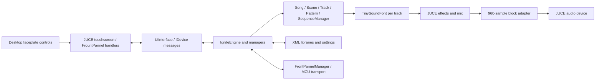

# Desktop bring-up handoff

Started 2026-10-28 from [MusicTribeOpenSource/0716-AAF](https://github.com/MusicTribeOpenSource/0716-AAF), upstream commit `0371a3ea22fc530e23e2321068a0b8835e1e6502`. Working branch: `desktop-build`. Application version: 0.3.3. Local checkout: `E:\BehringerKick\0716-AAF`. The adjacent KICK repository is separate.

## Architecture

`Common.cpp`, `Firmware.cpp` and `ignite_ui.cpp` each include many implementation files as unity modules. Edit an included file and rebuild the enclosing module. The separate `AudIO` and `ComProtocol` trees are useful reference material but are not linked by the main application target.

The second reliability pass is described in [AUDIT_FIXES.md](AUDIT_FIXES.md), including reproducible failures, copy/lifetime fixes, normal Save command persistence, clock and playback editing checks, staged saves and Windows device-rate conversion.

## Repairs and additions

- Preserve `DOWNLOAD_ONLY` when the bundled CPM handles a local source override. Otherwise JUCE is configured twice and produces duplicate-target errors.
- Check/reapply the JUCE patch against the source tree; the original per-build marker failed when another build directory reused an already patched checkout.
- Set C++17 consistently, remove a target property set before the application exists, make timestamps optional, and make MSVC Release warnings-as-errors opt-in while inherited warnings are investigated.
- Copy assets and an optional bank to the actual configuration's executable directory.
- Load a runtime-selected or adjacent SoundFont, guard absent fonts in song/track setup, and clear absent-font renders.
- Move Windows data out of `C:\Ignite_Files` into a user-writable application directory, with a test override.
- Adapt fixed internal audio blocks to the device callback length, including partial blocks and disconnected output channels.
- Repair thread start/join bookkeeping, queue locking and no-wait reads; allow desktop shutdown to release waiting workers.
- Stop Windows hardware polling when no MCU transport exists, wait when the decoder has no data, and let the Windows timer shut down and respect pause.
- Stop the UI publisher/watchdog on shutdown; remove duplicate deletion of the globally owned engine.
- Add the interactive SVG faceplate reconstructed from the supplied flat render, keyboard shortcuts, file logging, startup snapshots and application self-tests. Regenerate its editable artwork with `python scripts/make_panel_svg.py`.
- Add reproducible audio/queue/SF2 tests, a generated original test font, a real-bank WAV probe and a read-only preset inventory tool.

The faceplate is vector artwork reconstructed from the user's product-render reference. The Behringer and IGNITE names remain trademarks. See the [trademark policy](https://github.com/MusicTribeOpenSource/.github/blob/main/TRADEMARKS.md).

## Evidence and limits

Verified on Windows x64 with MSVC 19.44, Windows SDK 10.0.26100, CMake 4.3 and JUCE 7.0.12:

| Check | Result |
|---|---|
| Debug application build | Passed. Debug exit leak-report delay remains below. |
| Release application and helper builds | Passed. |
| Native regression runner | **82/82 Release and ASan checks; 83/83 Debug checks** (the extra Debug check measures string allocation release). |
| Release app without a SoundFont | Seven application checks passed; SVG and touchscreen captured; normal exit code 0. |
| Release app with CT4MGM | Seven application checks passed, including real track DSP rendering; normal exit code 0. |
| Full create/edit/save/reopen workflow | **58 create/edit + 49 fresh-process checks passed in Release and under AddressSanitizer**, including real Windows audio at 44.1 kHz and interrupted-save recovery. |
| Desktop feature round trip | **50 arrangement setup + 21 feature + 4 fresh-process checks pass in Release and ASan**, covering internal MIDI, step/live recording, non-GM preset preview/assignment, preferences and backup/restore. |
| Missing-font workflow | **50 create/edit + 41 reopen checks pass under ASan** without a SoundFont. |
| Standalone support libraries | AudIO_Core, DAW_Core, AirWindows_plugins and IgnitePacketProtocol build in Release. Protocol checks pass **5/5**. |
| Actual SF2 probe | 329 presets loaded; piano, bass, strings, lead and drums rendered finite, non-silent audio into a four-second WAV. |
| SVG validation | XML parsed; no embedded raster images. |
| Source formatting | `git diff --check` passed. |

Final Release workflow evidence: `Source/Application/build/workflow/20261028-151350/results.json`. Final Release feature evidence: `Source/Application/build/features/20261028-151408/results.json`. Final Release smoke evidence: `Source/Application/build/smoke/20261028-151425/results.json` and its case logs/PNGs. ASan evidence: `build/features/20261028-151101`, `build/workflow/20261028-151204` (device audio and recovery), and `build/workflow/20261028-151308` (missing font), relative to `Source/Application`. All processes exited normally; no sanitizer report was generated for these final runs. The latest audio device was Realtek at 48 kHz; the earlier reliability pass separately exercised JIB headphones at 44.1 kHz.

The bank probe and WAV are `Source/Application/build/ct4mgm-preview.{log,wav}`. The screenshot is also saved at [images/ignite-simulator.png](images/ignite-simulator.png). The faceplate SVG is [Source/Application/assets/ignite-panel.svg](../Source/Application/assets/ignite-panel.svg). See [DESKTOP_FEATURES.md](DESKTOP_FEATURES.md) for the new settings and backup workflow, and `scripts/build-windows.ps1 -DebugBuild -Package` for the combined build/check/package command.

See [BUILD_WINDOWS.md](BUILD_WINDOWS.md) for repeatable commands and [CAPABILITIES.md](CAPABILITIES.md) for source-backed feature boundaries. Regression output and smoke logs/screenshots are in ignored build directories; exploratory logs and the rendered CT4MGM WAV are also in `E:\BehringerKick\devtools`.

This is an initial desktop bring-up, not a completed code audit. Successful tests do not establish device-image completeness, hardware accuracy, all editing operations, timing under load, or every possible project edit during playback. The tested playback edits and copy/save operations are listed in AUDIT_FIXES.md. Existing compiler warnings include functions missing returns and unreachable code. Further lifecycle/concurrency review is needed for detached MIDI/timer tasks and background file operations.

Debug exit is also a known limitation: after the window and worker threads stop, the retained singleton UI graph produces an enormous CRT allocation leak dump. The debugger-output capture confirmed the exit delay was then in leak reporting, not the joined worker queues. Use Release for smoke tests and normal use; full UI/engine ownership cleanup is still required.

## Compact monitor layout

Desktop.2 adds a default Compact layout alongside the SVG Hardware layout. `DesktopPanel` repositions the existing control objects and transforms the same 1024×600 touchscreen; switching does not create another UI/model instance. All 69 original controls remain present. A fixed toolbar selects either layout and opens Desktop Settings. `PanelLayout` shares the existing `desktop.json` preferences through `DesktopPreferences.h`; command-line overrides do not overwrite the saved selection.

Window startup dimensions account for JUCE's monitor work area, including display scaling. Compact keeps the touchscreen aspect ratio and reduces control spacing at small heights. Layout validation covers 960×540, 960×600, 1280×720 and 1366×768 content sizes, non-overlapping controls, repeated switches, selected-song/screen lifetime, navigation/SHIFT, fresh-process preferences and temporary overrides. Toolbar buttons leave keyboard focus available for firmware shortcuts.

Run `scripts/layout-windows.ps1 -Configuration Release`, or add `-Configuration RelWithDebInfo -BuildDirectory asan` with the sanitizer runtime on PATH. The three-process layout suite passes **46 + 9 + 6 = 61 checks** in Release (`build/layout/20261028-181346`) and ASan (`build/layout/20261028-181226`), relative to `Source/Application`. Release and Debug rebuilds passed. Existing desktop-feature regression coverage is also rerun for this release; see the release notes.

Desktop.2 regression evidence: `build/features/20261028-181501` (75 Release checks), `build/features/20261028-181439` (75 ASan checks), `build/workflow/20261028-181548` (107 Release checks, device audio and interrupted-save recovery), and `build/smoke/20261028-181615` (seven checks with a bank and seven without). All processes exited normally. The final ASan layout/feature runs generated no address-error report.

## Working conventions

- `origin` is the community fork `chillbeast/0716-AAF`; `upstream` is Music Tribe. The user authorized the fork, pushes and community releases. Do not push changes to upstream.
- Keep sample banks, personal settings and build outputs out of commits.
- Do not change or terminate the user's KICK simulator while working here.
- Build from PowerShell on this Windows host. Desktop checks can run without IGNITE hardware.

## Desktop.3 verification

Release, Debug and AddressSanitizer builds succeed. Native checks pass 82/82 in Release and ASan, 83/83 in Debug. The final Release suites pass: correctness 107 (50 setup + 53 MIDI/save/editor + 4 reopen), desktop features 75, layouts 61, workflow/audio/recovery 107, smoke 7 with a bank and 7 without, protocol 5. The same correctness, feature, layout and audio/recovery workflows pass under ASan without address-error reports. Counts include repeated arrangement setup; they are not unique supported features.

Local evidence, relative to `Source/Application/build`:

| Suite | Release | ASan |
|---|---|---|
| MIDI/save/editor correctness | `correctness/20261028-193921` | `correctness/20261028-193922` |
| MIDI recording, SoundFonts, backup | `features/20261028-193940` | `features/20261028-193446` |
| Compact/hardware layouts | `layout/20261028-193955` | `layout/20261028-193558` |
| Device audio and interrupted-save recovery | `workflow/20261028-194011` | `workflow/20261028-193701` |
| Font/no-font smoke | `smoke/20261028-194024` | ? |
| Missing-font workflow (91 checks) | ? | `workflow/20261028-194113` |

The CV settings pending-change check was added after the first ASan feature/layout pass; the final correctness pass explicitly covers editing and saving CV configuration. No physical CV voltage or calibration validation is implied. No MIDI input devices were available; internal messages exercise the actual router.
