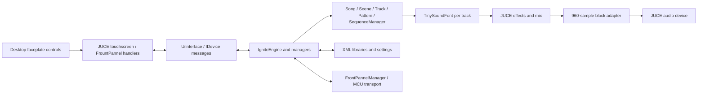

# Desktop bring-up handoff

Started 2026-10-28 from [MusicTribeOpenSource/0716-AAF](https://github.com/MusicTribeOpenSource/0716-AAF), upstream commit `0371a3ea22fc530e23e2321068a0b8835e1e6502`. Working branch: `desktop-build`. Application version: 0.3.3. Local checkout: `E:\BehringerKick\0716-AAF`. The adjacent KICK repository is separate.

## Architecture

`Common.cpp`, `Firmware.cpp` and `ignite_ui.cpp` each include many implementation files as unity modules. Edit an included file and rebuild the enclosing module. The separate `AudIO` and `ComProtocol` trees are useful reference material but are not linked by the main application target.

The second reliability pass is described in [AUDIT_FIXES.md](AUDIT_FIXES.md), including reproducible failures, copy/lifetime fixes, normal Save command persistence, clock and playback editing checks, staged saves and Windows device-rate conversion.

## Repairs and additions

- Preserve `DOWNLOAD_ONLY` when the bundled CPM handles a local source override. Otherwise JUCE is configured twice and produces duplicate-target errors.
- Check/reapply the JUCE patch against the source tree; the original per-build marker failed when another build directory reused an already patched checkout.
- Set C++17 consistently, remove a target property set before the application exists, make timestamps optional, and make MSVC Release warnings-as-errors opt-in while inherited warnings are investigated.
- Copy assets and an optional bank to the actual configuration's executable directory.
- Load a runtime-selected or adjacent SoundFont, guard absent fonts in song/track setup, and clear absent-font renders.
- Move Windows data out of `C:\Ignite_Files` into a user-writable application directory, with a test override.
- Adapt fixed internal audio blocks to the device callback length, including partial blocks and disconnected output channels.
- Repair thread start/join bookkeeping, queue locking and no-wait reads; allow desktop shutdown to release waiting workers.
- Stop Windows hardware polling when no MCU transport exists, wait when the decoder has no data, and let the Windows timer shut down and respect pause.
- Stop the UI publisher/watchdog on shutdown; remove duplicate deletion of the globally owned engine.
- Add the interactive SVG faceplate reconstructed from the supplied flat render, keyboard shortcuts, file logging, startup snapshots and application self-tests. Regenerate its editable artwork with `python scripts/make_panel_svg.py`.
- Add reproducible audio/queue/SF2 tests, a generated original test font, a real-bank WAV probe and a read-only preset inventory tool.

The faceplate is vector artwork reconstructed from the user's product-render reference. The Behringer and IGNITE names remain trademarks. See the [trademark policy](https://github.com/MusicTribeOpenSource/.github/blob/main/TRADEMARKS.md).

## Evidence and limits

Verified on Windows x64 with MSVC 19.44, Windows SDK 10.0.26100, CMake 4.3 and JUCE 7.0.12:

| Check | Result |
|---|---|
| Debug application build | Passed. Debug exit leak-report delay remains below. |
| Release application and helper builds | Passed. |
| Native regression runner | **84/84 Release and ASan checks; 85/85 Debug checks** (the extra Debug check measures string allocation release). |
| Release app without a SoundFont | Seven application checks passed; SVG and touchscreen captured; normal exit code 0. |
| Release app with CT4MGM | Seven application checks passed, including real track DSP rendering; normal exit code 0. |
| Full create/edit/save/reopen workflow | **58 create/edit + 49 fresh-process checks passed in Release and under AddressSanitizer**, including real Windows audio at 44.1 kHz and interrupted-save recovery. |
| Desktop feature round trip | **50 arrangement setup + 21 feature + 4 fresh-process checks pass in Release and ASan**, covering internal MIDI, step/live recording, non-GM preset preview/assignment, preferences and backup/restore. |
| Missing-font workflow | **50 create/edit + 41 reopen checks pass under ASan** without a SoundFont. |
| Standalone support libraries | AudIO_Core, DAW_Core, AirWindows_plugins and IgnitePacketProtocol build in Release. Protocol checks pass **5/5**. |
| Actual SF2 probe | 329 presets loaded; piano, bass, strings, lead and drums rendered finite, non-silent audio into a four-second WAV. |
| SVG validation | XML parsed; no embedded raster images. |
| Source formatting | `git diff --check` passed. |

Final Release workflow evidence: `Source/Application/build/workflow/20261028-151350/results.json`. Final Release feature evidence: `Source/Application/build/features/20261028-151408/results.json`. Final Release smoke evidence: `Source/Application/build/smoke/20261028-151425/results.json` and its case logs/PNGs. ASan evidence: `build/features/20261028-151101`, `build/workflow/20261028-151204` (device audio and recovery), and `build/workflow/20261028-151308` (missing font), relative to `Source/Application`. All processes exited normally; no sanitizer report was generated for these final runs. The latest audio device was Realtek at 48 kHz; the earlier reliability pass separately exercised JIB headphones at 44.1 kHz.

The bank probe and WAV are `Source/Application/build/ct4mgm-preview.{log,wav}`. The screenshot is also saved at [images/ignite-simulator.png](images/ignite-simulator.png). The faceplate SVG is [Source/Application/assets/ignite-panel.svg](../Source/Application/assets/ignite-panel.svg). See [DESKTOP_FEATURES.md](DESKTOP_FEATURES.md) for the new settings and backup workflow, and `scripts/build-windows.ps1 -DebugBuild -Package` for the combined build/check/package command.

See [BUILD_WINDOWS.md](BUILD_WINDOWS.md) for repeatable commands and [CAPABILITIES.md](CAPABILITIES.md) for source-backed feature boundaries. Regression output and smoke logs/screenshots are in ignored build directories; exploratory logs and the rendered CT4MGM WAV are also in `E:\BehringerKick\devtools`.

This is an initial desktop bring-up, not a completed code audit. Successful tests do not establish device-image completeness, hardware accuracy, all editing operations, timing under load, or every possible project edit during playback. The tested playback edits and copy/save operations are listed in AUDIT_FIXES.md. Existing compiler warnings include functions missing returns and unreachable code. Further lifecycle/concurrency review is needed for detached MIDI/timer tasks and background file operations.

Debug exit is also a known limitation: after the window and worker threads stop, the retained singleton UI graph produces an enormous CRT allocation leak dump. The debugger-output capture confirmed the exit delay was then in leak reporting, not the joined worker queues. Use Release for smoke tests and normal use; full UI/engine ownership cleanup is still required.

## Compact monitor layout

Desktop.2 adds a default Compact layout alongside the SVG Hardware layout. `DesktopPanel` repositions the existing control objects and transforms the same 1024×600 touchscreen; switching does not create another UI/model instance. All 69 original controls remain present. A fixed toolbar selects either layout and opens Desktop Settings. `PanelLayout` shares the existing `desktop.json` preferences through `DesktopPreferences.h`; command-line overrides do not overwrite the saved selection.

Window startup dimensions account for JUCE's monitor work area, including display scaling. Compact keeps the touchscreen aspect ratio and reduces control spacing at small heights. Layout validation covers 960×540, 960×600, 1280×720 and 1366×768 content sizes, non-overlapping controls, repeated switches, selected-song/screen lifetime, navigation/SHIFT, fresh-process preferences and temporary overrides. Toolbar buttons leave keyboard focus available for firmware shortcuts.

Run `scripts/layout-windows.ps1 -Configuration Release`, or add `-Configuration RelWithDebInfo -BuildDirectory asan` with the sanitizer runtime on PATH. The three-process layout suite passes **46 + 9 + 6 = 61 checks** in Release (`build/layout/20261028-181346`) and ASan (`build/layout/20261028-181226`), relative to `Source/Application`. Release and Debug rebuilds passed. Existing desktop-feature regression coverage is also rerun for this release; see the release notes.

Desktop.2 regression evidence: `build/features/20261028-181501` (75 Release checks), `build/features/20261028-181439` (75 ASan checks), `build/workflow/20261028-181548` (107 Release checks, device audio and interrupted-save recovery), and `build/smoke/20261028-181615` (seven checks with a bank and seven without). All processes exited normally. The final ASan layout/feature runs generated no address-error report.

## Working conventions

- `origin` is the community fork `chillbeast/0716-AAF`; `upstream` is Music Tribe. The user authorized the fork, pushes and community releases. Do not push changes to upstream.
- Keep sample banks, personal settings and build outputs out of commits.
- Do not change or terminate the user's KICK simulator while working here.
- Build from PowerShell on this Windows host. Desktop checks can run without IGNITE hardware.

## Desktop.3 verification

Release, Debug and AddressSanitizer builds succeed. Native checks pass 82/82 in Release and ASan, 83/83 in Debug. The final Release suites pass: correctness 107 (50 setup + 53 MIDI/save/editor + 4 reopen), desktop features 75, layouts 61, workflow/audio/recovery 107, smoke 7 with a bank and 7 without, protocol 5. The same correctness, feature, layout and audio/recovery workflows pass under ASan without address-error reports. Counts include repeated arrangement setup; they are not unique supported features.

Local evidence, relative to `Source/Application/build`:

| Suite | Release | ASan |
|---|---|---|
| MIDI/save/editor correctness | `correctness/20261028-193921` | `correctness/20261028-193922` |
| MIDI recording, SoundFonts, backup | `features/20261028-193940` | `features/20261028-193446` |
| Compact/hardware layouts | `layout/20261028-193955` | `layout/20261028-193558` |
| Device audio and interrupted-save recovery | `workflow/20261028-194011` | `workflow/20261028-193701` |
| Font/no-font smoke | `smoke/20261028-194024` | ? |
| Missing-font workflow (91 checks) | ? | `workflow/20261028-194113` |

The CV settings pending-change check was added after the first ASan feature/layout pass; the final correctness pass explicitly covers editing and saving CV configuration. No physical CV voltage or calibration validation is implied. No MIDI input devices were available; internal messages exercise the actual router.

## Desktop.4 audio verification

Release, Debug and ASan builds succeed. Native checks pass 84/84 Release/ASan and 85/85 Debug. The new sound suite totals 99 checks: 50 setup, 36 audio/effects/bank tests, 4 fresh-process backup checks, 4 missing-assigned-bank checks, and 5 missing-default-bank checks. Two generated original SF2 fixtures provide different left/right pitches and a different second bank. Rendering, preview, MIDI pan, polyphony, EQ response, reverb tails, chorus, per-synth release, undo, storage, stereo block handling and bank-failure isolation are covered.

The existing correctness (107), feature (75), layout (61), workflow/audio/recovery (107), missing-font workflow (91 ASan) and font/no-font smoke suites are rerun. Counts include repeated setup. Tests use disposable data and internally generated MIDI; physical MIDI/CV/clock behavior and maximum aggregate real-time polyphony remain unqualified.

Desktop.4 evidence (relative to `Source/Application/build`):

| Suite | Release | ASan |
|---|---|---|
| Stereo/effects/multi-bank (99) | `sound/20261028-213056` | `sound/20261028-212759` |
| MIDI/save/editor (107) | `correctness/20261028-213119` | `correctness/20261028-212939` |
| Recording/SF2/archive (75) | `features/20261028-213129` | `features/20261028-213007` |
| Layouts (61) | `layout/20261028-213143` | `layout/20261028-213039` |
| Device/recovery workflow (107) | `workflow/20261028-213159` | `workflow/20261028-213124` |
| Missing-font workflow (91) | - | `workflow/20261028-213156` |
| Font/no-font smoke (14) | `smoke/20261028-213212` | - |

All listed processes exit normally with no failing checks. The final sanitizer run produces no address-error report. The manual screenshot uses the generated bank-42 fixture and shows the actual revised SoundFonts controls.

The desktop shortcut launcher also permits a missing saved default bank, allowing explicitly assigned banks to work. Mocked launch checks cover missing saved defaults, explicitly invalid paths and valid relative paths without opening another app instance.

## Desktop.5 media verification

The Projects tab now runs song/scene WAV and MIDI exports in a private child engine and imports MIDI clips into the pattern library. New headers are `DesktopMedia{Snapshot,Job,Render,Test}.h` and `DesktopMidiImport.h`. The snapshot preserves unsaved data without saving or mutating the parent; the child has a separate data directory, no live MIDI routing/clock, and inline sequencer pulses. Temporary output replaces the destination only on success. Track effects now persist in song XML. Controller transposition and held notes across bars are repaired.

The 88-check media suite comprises 50 arrangement setup, 33 export/import checks and five fresh-process checks. Original MIDI and stereo SF2 fixtures cover WAV frame counts and format, scene/song export, stems, two-tempo MIDI, unsaved snapshots, parent edit isolation, clip import/save/reopen, failed/cancelled jobs, a locked destination, saved EQ restoration, controller/pressure transpose and notes spanning bars. Run `scripts/media-windows.ps1 -Configuration Release`, or use `-Configuration RelWithDebInfo -BuildDirectory asan` with the MSVC runtime on PATH. The combined build script runs it after the sound suite.

Release, Debug and ASan builds succeed. Native counts remain 84 Release/ASan and 85 Debug. Media (88), sound (99), correctness (107), features (75), layouts (61), device/recovery workflow (107), ASan no-font workflow (91), and Release font/no-font smoke (14) pass. Counts include repeated setup. Existing protocol/support libraries are unchanged from desktop.4 and were not rebuilt for this pass. No physical MIDI devices are used.

Desktop.5 regression evidence, relative to `Source/Application/build`:

| Suite | Release | ASan |
|---|---|---|
| Media (88) | `media/20261028-225928` | `media/20261028-225654` |
| Stereo/effects/banks (99) | `sound/20261028-230049` | `sound/20261028-225803` |
| MIDI/save/editor (107) | `correctness/20261028-230112` | `correctness/20261028-225934` |
| Recording/SF2/archive (75) | `features/20261028-230125` | `features/20261028-230047` |
| Layouts (61) | `layout/20261028-230142` | `layout/20261028-230140` |
| Device/recovery (107) | `workflow/20261028-230202` | `workflow/20261028-230257` |
| No-font workflow (91) | - | `workflow/20261028-230405` |
| Font/no-font smoke (14) | `smoke/20261028-230217` | - |

Final rebuilt binaries also pass media at `media/20261028-230619` (Release) and `media/20261028-230726` (ASan), and features at `features/20261028-230725` (Release) and `features/20261028-230841` (ASan). Independent RIFF/SMF header checks confirm float32 stereo 48 kHz WAV and type 1, 960-PPQ MIDI. Final sanitizer prefixes are `asan_desktop5` and `asan_desktop5_publish`; neither produces an address-error report. The 22-page manual includes the actual Projects screenshot and documents clip-only import, main-pattern export, random directions, scene release/tail behavior and external sample paths.

## Desktop.6 MIDI song verification

`DesktopMidiSong.h` plans type 0/1 PPQ files into named track/port/channel parts, tempo/meter/marker sections and bounded pattern data before touching the live model. It requires an idle, saved session before installing a new song, with existing songs retained. New instruments/patterns stay in memory until Save All. Editing histories reset to the new selection. GM percussion maps to SF2 bank 128; program changes, controller/bend state and Reset Controllers are handled across scene boundaries.

Meter metadata now travels through SceneData, copies, XML, export snapshots and MIDI conductor tracks. Older files default to 4/4. Fractional scene tempos use double XML reads, and song/scene writers retain float precision. Malformed tempo/meter payloads are validated before JUCE reads their data or converts denominator exponents; clip import shares the checks.

The generated song fixture has four scenes, two parts, fractional tempos, a 4/4-to-3/4 change, marker labels, program/bank changes, drums and crossing notes. The 103-check suite consists of 50 arrangement setup, 41 song checks and 12 reopen checks. It verifies unsaved-work protection, retention of the previous song, saved selection and metadata, MIDI/WAV round trips and durations, type 0 support, type 2/SMPTE rejection, malformed metadata, excess scenes/parts and controller reset state. The runner is `scripts/midi-song-windows.ps1`; use the usual ASan configuration/runtime options. It is included in the combined normal build/check script.

Scene boundaries round to sixteenths and note/event timing to 48 ticks/quarter. Cross-scene notes retrigger; pedal-held notes and release/effect tails are not continuous across scenes. Long/fine meters retain MIDI signatures with a normalised global bar grid. SysEx and original external-synth state are not reconstructed. Physical MIDI/CV/clock and complete SF2 modulation remain unqualified.

Desktop.6 regression evidence, relative to `Source/Application/build`:

| Suite | Release | ASan |
|---|---|---|
| MIDI songs (103) | `midi-song/20261029-013613` | `midi-song/20261029-013429` |
| Media (88) | `media/20261029-013215` | `media/20261029-012814` |
| Sound (99) | `sound/20261029-013239` | `sound/20261029-012909` |
| MIDI/save/editor (107) | `correctness/20261029-013312` | `correctness/20261029-013003` |
| Features (75) | `features/20261029-013330` | `features/20261029-013032` |
| Layouts (61) | `layout/20261029-013347` | `layout/20261029-013133` |
| Device/recovery (107) | `workflow/20261029-013403` | `workflow/20261029-013224` |
| Font/no-font smoke (14) | `smoke/20261029-013417` | - |
| No-font workflow (91) | - | `workflow/20261029-013610` |

Release/Debug/ASan builds and native checks pass (84/85/84). The final controller-reset change affects song import; its new regression is included in the final 103-check runs above. Final rebuilt feature checks also pass, at Release `features/20261029-013632` and ASan `features/20261029-013508`. The sanitizer prefixes `asan_song6`, `asan_song6_regression` and `asan_song6_publish` produce no address-error report. The manual has 23 pages and an actual Projects screenshot. Counts overlap through repeated setup; physical I/O and complete external-synth equivalence are not established.

## Desktop.7 MIDI fidelity verification

`DesktopMidiNotes.h` now pairs physical key events while separately tracking pedal-held sounding duration. Import recreates pedal-held voices in later scenes until release; channel-mode note endings, All Sound Off and Reset Controllers prevent terminated voices from reappearing. Physical key duration remains intact in its starting scene. Parameter-state reconstruction retains ordered RPN/NRPN/data-entry events and reset semantics. Voices still retrigger envelopes at scene changes, and effect/release tails remain discontinuous.

`DesktopMidiPorts.h` shares the actual route validation: DIN IDs 0-4 and USB IDs 13-23, with CV IDs 5-12 excluded. Desktop.6 used a dense 0-15 assumption during file import and clamped later USB destinations. New checks cover every valid MIDI ID and each CV exclusion. External-only MIDI export now emits port metadata without requiring program initialization. Unrouted internal instruments use USB device 1 (ID 13). Zero tempo/malformed port payloads are rejected in both import paths, and clip parsing retains original overlapping note events rather than JUCE-generated replacement note-offs.

The final MIDI song suite totals 131 checks (50 setup, 69 song/audio, 12 reopen); media totals 93 (50 setup, 38 media, five reopen). A rendered pedal fixture remains audible beyond the scene boundary and ends after pedal release. An independent Standard MIDI File parser confirms external host-5 output has port 23, two notes and no program change; unrouted internal output has port 13, two notes and program initialization.

Desktop.7 evidence, relative to `Source/Application/build`:

| Suite | Release | ASan |
|---|---|---|
| MIDI songs (131) | `midi-song/20261029-110729` | `midi-song/20261029-110647` |
| Media (93) | `media/20261029-110751` | `media/20261029-110747` |
| Sound (99) | `sound/20261029-110021` | `sound/20261029-105719` |
| MIDI/save/editor (107) | `correctness/20261029-110040` | `correctness/20261029-105815` |
| Features (75) | `features/20261029-110051` | `features/20261029-105906` |
| Layouts (61) | `layout/20261029-110106` | `layout/20261029-105948` |
| Device/recovery (107) | `workflow/20261029-110121` | `workflow/20261029-110032` |
| Font/no-font smoke (14) | `smoke/20261029-110134` | - |
| No-font workflow (91) | - | `workflow/20261029-110239` |

Release/Debug/ASan builds and native checks pass (84/85/84). The final port correction is covered by the two expanded suites above; other application/backend code is unchanged by that correction. Sanitizer prefixes `asan_fidelity7`, `asan_fidelity7_final` and `asan_fidelity7_ports` produce no address-error reports. The manual has 23 pages and explains conversion/re-import and route limitations. Counts include repeated setup. VST integration, complete SF2 modulators and physical I/O qualification remain separate outstanding work.

## Desktop.8 full SF2 engine and third layout

Windows uses the pinned static FluidSynth 2.6.1 backend through `SoundFontRuntime.h`.
It shares loaded bank samples/modulators via virtual SoundFont proxies, with one
independent synth per track. JUCE continues to own audio/MIDI devices and panel
post-effects. Firmware/non-Windows keeps TinySoundFont. The probe uses the desktop
backend and writes stereo WAV.

`IgniteSoundFontCompatibility` generates original banks and runs 31 checks for
instrument/preset modulators, global/local/default overrides, source direction,
curves and amount sources, wheel/pressure, native effect sends, RPN and controller
preservation, Unicode filenames, linked stereo and the low bytes of 24-bit samples.
Native SF2 envelopes/controllers differ from TinySoundFont; steady-state pan and
expression assertions allow one 20 ms controller-smoothing block first. The SF2
default expression modulator has a finite 96 dB attenuation range; the near-silence
check requires at least 80 dB reduction rather than TinySoundFont's exact zero.

All Sound Off drains pending voices, then clears native reverb/chorus histories
using reset hooks from the pinned static library. It keeps channel/RPN/NRPN state
without a MIDI system reset. The regression catches an active held note reviving
when envelope generators are reset before termination finishes. Normal Panic
still resets controllers. Shutdown unloads active/audition synths and banks before
C++ thread-local destruction; ASan exposed the previous global teardown ordering.
Original legacy test SF2 INFO strings now have the even sizes required by SF2;
RIFF outer padding alone was insufficient for FluidSynth's structural validation.

Touchscreen is a third `DesktopPanel::Layout`, saved as `PanelLayout=touchscreen`.
All 69 controls stay allocated but hidden. The same screen/session remains, with
aspect-preserving sizing and the mode/settings toolbar. CLI/launcher overrides
are temporary. The expanded layout suite totals 111 checks over five launches,
including saved startup, all overrides, hidden controls, maximum display area,
keyboard navigation, resize and repeated mode changes.

Packages carry the LGPL license and complete corresponding FluidSynth source
(including the test/doc-registration guard) under
`source/Source/Application/third_party/fluidsynth`. CMake selects that copy for
rebuilding/relinking. No SF2/SF3 files are packaged; SF3/libsndfile are disabled.
See [THIRD_PARTY_NOTICES.md](THIRD_PARTY_NOTICES.md).

Desktop.8 final evidence, relative to `Source/Application/build`:

| Suite | Release | ASan |
|---|---|---|
| MIDI/save/editor (107) | `correctness/20261029-121647` | `correctness/20261029-121512` |
| Stereo/effects/banks (99) | `sound/20261029-121659` | `sound/20261029-121614` |
| MIDI songs (131) | `midi-song/20261029-121718` | `midi-song/20261029-121711` |
| Media (93) | `media/20261029-121735` | `media/20261029-121749` |
| Features (75) | `features/20261029-121805` | `features/20261029-121842` |
| Layouts (111) | `layout/20261029-121821` | `layout/20261029-121917` |
| Device/recovery (107) | `workflow/20261029-121848` | `workflow/20261029-122028` |
| Font/no-font smoke (14) | `smoke/20261029-121902` | - |
| No-font workflow (91) | - | `workflow/20261029-122058` |

All runs pass with normal exits. Native tests pass 84 legacy + 31 full-SF2 in
Release/ASan and 85 + 31 in Debug. Final ASan prefix `asan_sf2_publish` produces
no address-error report. `sf2-packaged-relink` configures directly from packaged
corresponding source, rebuilds the engine/native tests, and passes 84 + 31 checks.
The private CT4MGM bank loads 329 presets (128/128 GM programs and 10 drum sets)
and renders five representative programs through the same backend. No private
banks are distributed. The manual is 24 pages. Counts include repeated setup;
physical MIDI/CV/clock and VST integration remain outside this verification.

## Desktop.9 First Light demo

`assets/demo/First Light Demo.mid` is an original CC0 16-bar arrangement at
112 BPM: four four-bar scenes (Intro, Groove, Lift, Outro) and five parts
(drums, finger bass, electric piano, marimba arp, square lead). The reproducible
source is `scripts/make-demo-midi.py`; it requires only the Python standard library.

Projects > Create demo song validates the default bank's required GM presets,
then uses the existing validated MIDI import plan to add/select/save a song.
Existing songs are retained. Unsaved work and active transport keep the import
blocked. An optional name prefix keeps normal MIDI import naming unchanged.
Demo output instruments use internal synthesis and port -1. Bank browsing is
independent: the default-bank preset query explicitly ignores the browsed bank.

`--install-demo` creates/saves the demo and exits for the source installer.
`scripts/install-demo-windows.ps1` installs a separate Documents/IGNITE Demo
project and Desktop shortcut, refusing an existing destination. It records an
external SF2 path, with no sample copy. The ordinary simulator libraries stay
separate. Project creation in the UI remains additive in its active library.

The new demo suite totals 86 checks: 50 existing setup, 28 demo/audio checks,
six fresh-process checks and two unavailable-bank checks. It verifies save/idle
protection, independent browser/default banks, internal assignments, 16 bars,
20 patterns, live Windows audio, all five rendered stems, full mix duration and
persistence. Release with the private CT4MGM bank passes at
`demo/20261029-124353`; ASan with original generated banks passes at
`demo/20261029-124222`. The real-bank mix peaks at 0.2452 with RMS 0.0293;
its 36.2857 seconds include the existing two-second export tail. A local PCM16
preview is saved only in the separate Documents demo project, never distributed.

Final UI feature checks pass at Release `features/20261029-124937` and ASan
`features/20261029-124906` (75 each). MIDI song regressions pass at Release
`midi-song/20261029-124444` (131); ASan passes at `midi-song/20261029-124946` (131). Final prefixes
`asan_demo9` and `asan_demo9_final` produce no address-error reports.
Release/Debug/ASan apps build. The latest Projects screenshot and manual explain
loading a default bank, previewing a sound, creating the demo and pressing Play.
