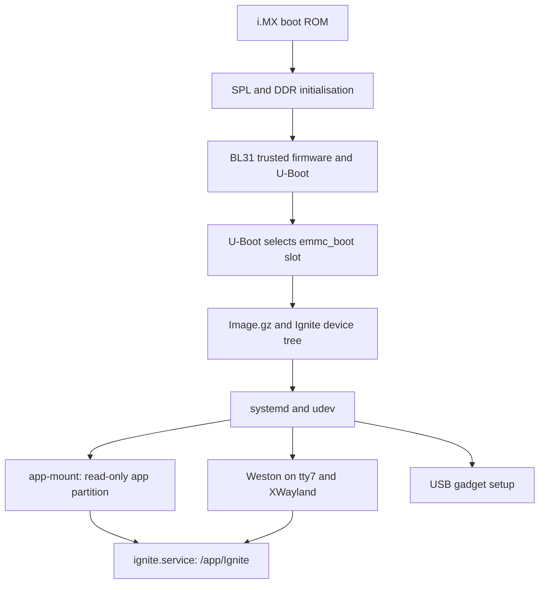

# IGNITE Linux OS guide and source audit

**Reviewed: 29 October 2026.** Based on community source commit
`1d9062d4` and the Linux tree inherited from upstream
`0371a3ea22fc530e23e2321068a0b8835e1e6502`.

IGNITE's device software runs on a custom **Buildroot Linux system for the NXP
i.MX8M Mini**, with a JUCE sequencer application, a graphical compositor and
board-specific drivers. The repository contains the OS build recipes, kernel and
bootloader patches, filesystem overlay and update scripts. It does not contain a
complete, tested, ready-to-flash device distribution.

This report is a source inspection, not a hardware teardown or a boot test. The
pinned upstream kernel and U-Boot Makefiles were also checked. **No Linux image
was built, installed or booted for this report.** Configured capacities and
enabled drivers are distinguished from measurements of a shipping unit. The
Windows simulator's successful tests do not qualify this Linux image.

## Quick reference

The main evidence is the [development configuration][br-dev],
[release configuration][br-rel], [kernel configuration][kernel-dev],
[board patch][board-patch] and [filesystem overlay][overlay].

| Item | What the source establishes |
|---|---|
| OS builder | Buildroot **2021.02.3**, from its actual [Makefile][br-make]. The generated configuration's `5.15.60_RT-...-dirty` banner is not the Buildroot release number. |
| Processor target | **AArch64, little endian, Cortex-A53**, i.MX8M Mini / `IMX8MM`. Board paths and DT identify a Variscite-derived VAR-SOM-MX8M-MINI design; U-Boot also uses VAR-DART base code. |
| CPU capacity | NXP's processor family supports up to four A53 cores at up to 1.8 GHz. This is a family capability, not a measured IGNITE clock or confirmed SKU. [NXP specifications][nxp]. |
| RAM described in DT | **2 GiB** region at `0x40000000`, length `0x80000000`, in the board patch. Verify actual fitted/usable memory on a unit. |
| Storage assumptions | eMMC is normally `/dev/mmcblk2`; SD is referenced as `mmcblk1`. The eMMC image template declares **14G**, but this does not establish the physical flash SKU or a complete partition layout. |
| Kernel | Pinned vendor source is **Linux 5.15.60**; the supplied RT series ends with local suffix **`-rt50`**. The mount script expects `5.15.60-rt50`. |
| Preemption / timer configuration | `CONFIG_PREEMPT_RT=y`, lazy preemption and `CONFIG_HZ=250`. These do not establish measured audio or MIDI latency. |
| Bootloader / trusted firmware | Variscite U-Boot **2020.04**, SPL and ARM Trusted Firmware BL31; NXP DDR firmware is also needed. |
| Toolchain | External Arm GNU **10.2-2020.11**, `aarch64-none-linux-gnu`, glibc, shared libraries and C++ support. |
| Init / basic userspace | **systemd 247.3**, udev and **BusyBox 1.33.0**; merged `/usr`; BusyBox `/bin/sh`; hostname `IGNITE`; UTC. |
| Graphics | NXP Weston branch `rel_imx_5.4.70_2.3.0`, DRM, Wayland, XWayland, Vivante/G2D. The branch name is not the kernel version. |
| Display evidence | Board patch specifies **1024 x 600** LCD timings at a 33 MHz pixel clock. Goodix GT911 touch coordinates are configured as **800 x 480**; confirm mapping on hardware. |
| Audio | ALSA, card 0, **48 kHz / S32_LE** in `asound.conf`; application internal blocks are **960 samples / 20 ms**. These are different layers of the audio path. |
| Main process | `/app/Ignite`, started by `ignite.service`; no `User=` is specified, so the system service defaults to root. Weston is requested as `weston@root.service`. |
| Persistent project files | `/data/ignite/Ignite_Files`; user/exchange volume `/home/ignite`; device SoundFont `/app/Ignite.sf2`. |
| Remote shell | Dropbear SSH, configured for **TCP 48042**. Overlay passwords for `root` and `ignite` are locked. |
| Updates | SWUpdate **2020.04**, A/B kernel/rootfs/app slots, plus an AES-CBC packaged USB update format. The supplied SWUpdate packages are unsigned. |

Package versions above are recipe versions, not a bill of materials recovered
from a running unit. See the [package recipes][packages] for the exact downloads.

## Contents

- [Boot and process layout](#boot-and-process-layout)
- [Storage and persistence](#storage-and-persistence)
- [Graphics, audio and timing](#graphics-audio-and-timing)
- [Hardware interfaces](#hardware-interfaces)
- [Networking and shell access](#networking-and-shell-access)
- [Build paths and image outputs](#build-paths-and-image-outputs)
- [Known build and installation gaps](#known-build-and-installation-gaps)
- [How updates work](#how-updates-work)
- [Read-only inspection on a device](#read-only-inspection-on-a-device)
- [Source map and open questions](#source-map-and-open-questions)

## Boot and process layout

The intended chain, reconstructed from [boot preparation][boot-prepare],
[U-Boot patches][uboot-patches] and the systemd units, is:



The [application service][app-service] requires the app mount and Weston, waits
five seconds before launching, restarts on failure after two seconds and sets a
10-second watchdog. The UI source sends `systemd-notify WATCHDOG=1`; a replacement
application must account for that service policy. The unit also has
`ConditionHost=IGNITE`: changing the hostname can prevent startup.

CPU and I/O weights are set to 10000, task/process limits are relaxed, open files
are capped at 65536 and `MemorySwapMax=0` is requested. These are resource policy
settings, not proof of a hard real-time application or a running FIFO scheduler.

The U-Boot patches also coordinate power-on GPIO state with the MCU. Replacing
the bootloader with an unmodified generic i.MX image would omit board behavior.
The console boot arguments use **`ttymxc3,115200`**. That identifies a Linux
console device and baud rate; it does not identify a safe physical connector,
pinout or voltage level.

The [systemd recipe][systemd-recipe] runs `systemctl --root=... preset-all` while
creating the root filesystem. A unit's presence or `WantedBy=` declaration alone
is still insufficient to prove it was enabled in a particular installed image.

## Storage and persistence

The [mount script][app-mount] and [update hooks][update-hook] agree on two boot
sets. The persistent volumes are described by [fstab][fstab].

| Partition, under the usual `mmcblk2` naming | Intended role | Evidence |
|---|---|---|
| `p1` | Slot A kernel and DTB | U-Boot `loadimage0` / `loadfdt0`; update hook |
| `p2` | Slot A root filesystem | Read-only root in U-Boot `mmcargs0` |
| `p3` | Slot A application | Mounted read-only at `/app` when `emmc_boot=0` |
| `p4` | Slot B kernel and DTB | U-Boot `loadimage1` / `loadfdt1`; update hook |
| `p5` | Slot B root filesystem | Read-only root in U-Boot `mmcargs1` |
| `p6` | Slot B application | Mounted read-only at `/app` when `emmc_boot=1` |
| `p7` | Factory files | `/factory`, ext4, read-only in fstab |
| `p8` | Application data | `/data/ignite`, ext4 with `data=journal` |
| `p9` | User/exchange files | `/home/ignite`, VFAT; also referenced by USB mass storage |

This is a **logical map inferred from runtime scripts**, not a verified disk
image layout. The supplied [eMMC genimage template][emmc-image] only has an
active raw bootloader entry; it does not define the nine partitions above. Its
commented examples are not an executable partition recipe. The
[SD template][sd-image] places a root filesystem at 8M and a raw bootloader at
33K after substitution; it is not the same as the A/B eMMC layout.

The configured rootfs image is **762M**. App image creation uses 254800 default
512-byte `dd` blocks: **130457600 bytes, about 124.4 MiB**. Neither value is the
physical flash capacity or necessarily the final partition size.

The root is intended to remain read-only. `/media` has a tmpfs mount unit. An
additional overlay setup uses a fixed PARTUUID
`70bac298-bdec-11eb-8dd6-6330df167a58` for `/media/az01-internal`, with an OverlayFS
upper/work pair for `/var`. Its initializer may **format that partition** if it
does not recognize an ext filesystem. Fstab also declares tmpfs for `/var`.
Verify the effective mounts on a real build; these files do not establish that
all writable state is ephemeral or that `/etc` is writable.

Linux project storage comes from [EngineFileHandler.cpp][file-handler]. It is
separate from the community Windows `%APPDATA%` storage model. A board backup
should include saved projects, instruments, patterns and calibration/configuration
data; copying only `/app/Ignite` does not preserve a complete device setup.

## Graphics, audio and timing

### Graphics

[Weston][weston-service] takes tty7, uses a PAM login session and writes its log
under `XDG_RUNTIME_DIR`. [weston.ini][weston-config] enables G2D and XWayland,
disables idle blanking and hides the desktop panel. The native application uses
JUCE's Linux/X11 stack, with XWayland available under Weston. This is a Linux
graphics session, rather than the app writing the framebuffer directly.

The board patch contains the 1024 x 600 panel timing, while the Goodix node keeps
800 x 480 touch coordinates. Treat these as source settings requiring validation,
not interchangeable display specifications. Configuration files also enable many
unrelated generic drivers; their presence is not evidence of extra physical I/O.

### Audio and synthesis

[asound.conf][alsa-config] selects ALSA hardware card 0 through plug/conversion
devices, with 48 kHz, signed 32-bit little-endian hardware samples. The default
application configuration enables JUCE audio and internal effects/mixing. Its
48 kHz, 960-sample internal block represents 20 ms of samples; that alone does not
measure the DAC's total latency or establish a selectable hardware buffer size.

The board patches add Coolaudio **CAM9000/M9000** codec support on SAI2 and I2C,
including a `coolaudio,cam9000` node at address `0x4d`. Follow those bindings when
changing the sound driver rather than choosing an arbitrary ALSA card index.

Linux expects a user-supplied **`/app/Ignite.sf2`**. The original General MIDI
bank is omitted; see the [SoundFont note][soundfont-note]. The community
**FluidSynth backend and desktop SoundFont-management features are Windows-only**
in this branch. Their tests do not show that they have been ported into the
embedded Linux build, whose synthesis path retains TinySoundFont code.

The development configuration includes JACK2. The release configuration removes
it; neither a package flag nor Weston's `After=jackd.service` proves a JACK server
is running. PulseAudio and PipeWire are not selected in the development config.

### Real-time and memory settings

The checked-in [patch series][kernel-series] explicitly orders board changes
before the RT patches. Its last patch changes `localversion-rt` to `-rt50`; the
subject mentions a 5.15.70 RT rebase, but the pinned base Makefile says **5.15.60**.
Use the built kernel's `uname -r` rather than treating that subject as its version.

`CONFIG_NR_CPUS=256` is a kernel maximum, not a 256-core processor. An application
pulse-thread helper contains affinity for CPUs 2 and 3 and `SCHED_OTHER`; some
call sites are disabled. Audit the active execution path before claiming CPU
isolation or FIFO real-time scheduling. Likewise, the kernel's 250 Hz setting
is not the sequencer's PPQN or MIDI clock frequency.

A [ZRAM setup script][zram] allocates one **512M compressed swap device**, and the
release kernel enables ZRAM. This is not another 512 MB of physical RAM.
The app unit's `MemorySwapMax=0` requests that the app itself avoid swap; inspect
the active cgroup setup and `swapon --show` before assuming either policy is in use.

## Hardware interfaces

| Interface | Source-level contract | Consequence for OS work |
|---|---|---|
| Front-panel MCU | `FrontPannelManager`: `/dev/ttymxc0`, 115200 baud | Buttons/encoders and board communication require the matching MCU/protocol. This is distinct from the `ttymxc3` console. |
| CV/Gate control | `/dev/cvctl_misc`, `CONFIG_MISC_IGNITE_CVGPIO=m`, custom ioctls; `/dev/i2c-1`, address `0x0c` in the I2C helper | Generic Linux alone does not supply this ABI or the board's calibration. |
| CV module loading | App mount script inserts `/lib/modules/5.15.60-rt50/kernel/drivers/misc/cvctl.ko` | Changing the kernel release requires updating this hard-coded path or adopting normal module loading. |
| Touch / display | Goodix GT911, LVDS panel and associated GPIO/I2C bindings | Preserve board revision changes in the DT patches. |
| USB device side | ConfigFS composite gadget: FunctionFS transfer, MIDI, ACM serial and mass storage | Gadget setup is part of the OS, not just the sequencer executable. |
| USB MIDI | Gadget script requests **six input and six output ports** | These counts are USB logical ports, not six DIN socket pairs. |
| USB serial | Kernel patch renames gadget `ttyGS` nodes to **`ttyVS`**; app references `/dev/ttyVS0` | Host tools or replacement kernels must account for that custom name. |
| USB host hotplug | udev invokes add/remove scripts; these signal Ignite with `SIGUSR1` / `SIGUSR2` | A different supervisor/process name may break the rescan behavior. |
| Removable storage | udev invokes `hostUsbMount.sh`, mounting under `/mnt/flash` | Inspect device selection and filesystem handling before using it with valuable media. |

Hardware ABI evidence is in [FrontPannelManager.cpp][front-panel],
[cvControl.h][cv-control], [i2cManager.cpp][i2c], the
[USB setup script][usb-setup] and [udev rules][udev].

The USB script advertises vendor/product IDs **1397:12cc**, a placeholder serial
number, six MIDI ports each way and a mass-storage backing device of
`/dev/mmcblk2p9`. It first launches the omitted **`/usr/bin/pcmode`** and waits
without a timeout for FunctionFS `ep1`. Without that service or a replacement,
the script cannot reach the later MIDI/ACM/storage links and final UDC binding.
The app also has FunctionFS code; the released tree does not demonstrate a
working replacement for the entire missing transfer service.

The gadget exposes the same volume that fstab mounts as `/home/ignite`.
Coordinating local mounts with a PC's mass-storage access is necessary; the script
alone does not demonstrate a complete ownership handoff.

## Networking and shell access

The normal configuration includes ConnMan, wpa_supplicant, DHCP client tools and
Dropbear. [wifi_setup.sh][wifi] raises `wlan0`, starts wpa_supplicant with
`/usr/lib/firmware/mrvl/wpa_supplicant.conf` and starts DHCP. That configuration has
no saved SSID or passphrase. The presence of the script does not prove its boot
activation on a particular image.

The [Linux README][linux-readme] says the omitted Wi-Fi blob is
`sd8987_uapsta.bin`. A later board patch instead describes `marvell,sd8997`.
Confirm the fitted module, driver firmware request and board revision before
selecting a blob; those two part numbers should not be silently treated as equal.
Bluetooth packages in a config also do not establish a tested product feature.

An `eth0.network` file sets **192.168.0.1/24**, with gateway and DNS also pointing
at 192.168.0.1. This is an image configuration, not evidence of an exposed Ethernet
jack. Use the unit's actual interface list and routes when diagnosing networking.

[Dropbear's unit][ssh-service] listens on **48042**, not the usual SSH port 22.
For a custom build with a configured account/key, the connection syntax is:

```sh
ssh -p 48042 YOUR_USER@DEVICE_ADDRESS
```

The overlay locks `root` and `ignite` passwords. Although the defconfigs retain a
legacy root-password setting, Buildroot applies the overlay after target-finalize
hooks; do not treat that setting as a usable installed password. Configure your
own image's access and inspect its generated `etc/shadow`. Do not assume that a
locked password by itself disables every SSH authentication method.

This is an image-built userspace, not a Debian installation. The helper's `apt`
commands run on the **build host**. There is no configured on-device apt workflow;
OPKG and RPM are also unselected. Normally, add tools through Buildroot, rebuild
and deploy the relevant image, or use binaries built against the matching SDK.

## Build paths and image outputs

### Choose the configuration

| Configuration | Intended use and meaningful differences |
|---|---|
| `Ignite_defconfig` | Development image. Builds the app in Debug; includes GDB/gdbserver, input/I2C/storage diagnostics, JACK2 and more utilities. |
| `Ignite-rel_defconfig` | Release image. Builds the app in Release; removes many diagnostics/JACK/extra backends, enables watchdog tooling and ZRAM-related configuration. |
| `Ignite_uuu_defconfig` | Separate provisioning-oriented profile/kernel config. Removes much of the normal wireless stack and adds different DHCP/libiio options. Its name is not a complete UUU flashing procedure. |

The profiles share the same kernel/U-Boot pins, 762M rootfs setting and overlay.
They are large saved configurations, not three minimal fragments. Read their
differences before assuming that a development tool exists in the release image.

### Host and build workflow

Use a Linux build host/VM and a Linux filesystem. [The checked-in Buildroot host
requirements][host-requirements] are the baseline. The legacy wrapper is written
for apt-based hosts and additionally installs JUCE-related development libraries.
The app requires CMake 3.20+, C++17 and downloads JUCE 7.0.12. Historical vendor
download locations, toolchain archives and license-gated NXP packages must still
be accessible or mirrored appropriately.

The upstream convenience entry point, from `Linux/`, is `./builder.sh Ignite`.
Read it first: it installs host packages, edits the PATH, deletes psplash patch
files, increments software-version metadata and chooses `make -j32`. CI scripts
also use root builds and broad permission changes. These are legacy automation
choices, not requirements of Buildroot itself.

The explicit workflow is below. **Resolve the gaps in the next section before
expecting the final `make` to produce installable images.**

```sh
# From the repository root, on the Linux host:
cd Linux/buildroot
make Ignite_defconfig                 # or Ignite-rel_defconfig
make menuconfig                       # review paths, packages and access policy
make -j"$(nproc)"                      # includes the board's post-image scripts
make sdk                              # produce the matching application SDK
```

The post-image scripts use hard-coded `output/` paths. A separate `O=...` build
directory needs corresponding script changes; it is not a drop-in option for
the whole legacy packaging pipeline.

For an application-only cross-build, after obtaining and preparing a matching
SDK, the current repository layout uses:

```sh
# From the repository root, with the matching SDK prepared:
cmake -S Source/Application -B build/ignite-arm \
  -DCMAKE_BUILD_TYPE=Release \
  -DCMAKE_TOOLCHAIN_FILE=/absolute/path/to/sdk/share/buildroot/toolchainfile.cmake
cmake --build build/ignite-arm --parallel
```

Run a generated SDK's relocation step if its accompanying instructions require
it. The command above describes the intended cross-build, not a build verified
by this report. An x86 Linux build is also not automatically a board-independent
simulator: the Linux application enables MCU/device paths by default.

### Expected products

After a repaired, successful pipeline, look under `Linux/buildroot/output/`:

| Location / artifact | Meaning |
|---|---|
| `host/`, `staging/` | Host tools, cross-toolchain and target sysroot |
| `target/` | Staged target files; not itself a ready-to-flash filesystem image |
| `images/Image.gz`, `imx8mm-var-som-ignite.dtb` | Kernel and board device tree |
| `images/imx8-boot-sd.bin` | Boot image assembled from SPL, DDR firmware, BL31 and U-Boot |
| `images/rootfs.ext4.gz`, `sdcard_linux.img`, `emmc.gpt.gz` | Rootfs and image-builder outputs; inspect the templates before installation |
| `images/ignite_apps.ext4.gz`, `appfs.tar.gz` | Application payload and assets |
| `images/Ignite.swu`, `Ignite_fullimage.swu` | Normal and full SWUpdate containers |
| `images/Ignite_*E.img`, `Ignite_full_*E.img` | Version-prefixed encrypted update containers |

Some intermediate tar files are removed by the update script. Names in this
table describe the scripts' intent, not artifacts produced during this audit.

## Known build and installation gaps

These are concrete source findings, not a claim that a full build was attempted.
The report does not change these scripts or the device partition scheme.

| Finding | Why it matters / what to reconcile |
|---|---|
| Legacy app checkout layout and branch | Both `create_sw_*images.sh` scripts clone into `output/AppTemp/Source`, then enter `Source/Application` relative to `AppTemp` and check out `ui_dev`. That expects `Application/` at the cloned repository root. This monorepo instead has `Source/Application/`, and its maintained branch is `desktop-build`. Setting `IGNITE_SOURCE_GIT_URL` alone does not repair the nested paths, copy paths or relative SDK reference. Pin the intended commit and adapt the layout. |
| Removed prebuilt bootloader still referenced | App image scripts copy `ignite/u-boot/imx-boot-imx8mm-ddr4-evk-sd.bin-flash_ddr4_evk`, which is absent. Genimage templates reference that same name, although boot preparation produces `imx8-boot-sd.bin`. Connect the built output to the image recipes. |
| Incomplete eMMC template | A 14G GPT container declaration is present, but active p1-p9 definitions are absent. Do not infer a factory flash map from its commented examples. |
| Missing MCU payload | `Ignite_MCU.hex` is omitted. The encrypted-container stage references it for normal and full images, including when the initial build profile is Debug. Kernel/rootfs work and a complete USB update bundle are different completion points. |
| Missing transfer service | The USB gadget setup waits indefinitely for an endpoint expected from omitted `pcmode`. This affects USB enumeration, not just file copying. |
| Wi-Fi identity needs confirmation | README/blob name says SD8987, later DT patch says SD8997; the private blob is absent. Match the actual module/driver before adding firmware. |
| Patch order is explicit | Buildroot's [patch loader][patch-loader] honors `series`, not a glob of every patch. All 187 listed files exist. `0183-Add-Ignite-spcific-midi-gadget-name.patch` is present but unlisted, so its special gadget naming change is not automatically applied. Board, codec, CV and `ttyVS` patches **are** listed. |
| Environment geometry differs | U-Boot config sets environment size `0x20000`, offset `0x400000` and redundant offset `0x500000`; overlay `fw_env.config` declares one `0x4000` region at `0x400000`. Validate against the installed bootloader before using `fw_setenv`. |
| Two kernel-partition filesystem conventions | Normal update metadata/preinstall formats the kernel slot as ext4; full-image metadata/preinstall uses VFAT. U-Boot generic `load` support does not make those recipes interchangeable without checking the actual layout. |
| Stale fixed paths and auxiliary units | Module loading names `5.15.60-rt50` explicitly; overlay mount units appear in a `media-az01/x2dinternal.mount` path rather than a normal flat escaped systemd filename; an SDMA service invokes `/etc/sdma`, not supplied by the overlay. Check the generated rootfs and unit activation. |

The [old `fwupgrade.sh`][legacy-upgrade] uses another `mmcpart`-based upgrade
scheme and formats partitions directly. It should not be mixed with the A/B
`emmc_boot` updater without reconciling both. No generic `dd`, partitioning or
flashing command is offered here because the released image recipes do not yet
establish a consistent, verified device layout.

## How updates work

The [SWUpdate packer][swu-packer] creates CRC-format cpio archives containing
`sw-description`, kernel/rootfs/app tarballs and shell hooks. The normal hook
targets the inactive slot: running root `p2` selects `p4/p5/p6`, while running
root `p5` selects `p1/p2/p3`. After installation it changes `emmc_boot` to select
the new set. That is A/B slot selection; the inspected code does not establish
automatic health-check rollback or a guaranteed power-loss recovery process.

The full-image hook also formats **`p7`**, described by fstab as the factory
partition, and writes the `data.tar.gz` payload there. Normal and full updates
therefore have materially different data effects. Neither should be described
as simply replacing the executable.

[createEncryptedImage.sh][encrypted-packer] wraps a `.swu`, MCU HEX and
`version.txt` in ext4, encrypts it with AES-256-CBC/PBKDF2/salt and prefixes a
version header. The corresponding decryption key is public in the source. This
is an update packaging convention, **not authenticity verification**; the supplied
SWUpdate configuration does not enable signed images. Preserve format
compatibility when experimenting, and separately design authentication if adding it.

The checked-in `/etc/software_version` says `Ignite_SW_2.0.4`,
`Control_SW_v2.0.1`, dated 2024-10-01; hardware compatibility says `Ignite 0.0.1`.
These are image metadata, distinct from application version 0.3.3 and this fork's
`desktop.N` tags. The first-boot RTC helper even uses the metadata date, so it
does not prove the date/time of manufacture or a live network time sync.

## Read-only inspection on a device

After establishing authorized shell access on your own unit/build, these commands
collect useful facts without requesting an update or changing partitions. Some
tools depend on the selected profile; report missing commands rather than
assuming they are installed.

```sh
# Identity, actual kernel and memory
cat /etc/os-release /etc/software_version /etc/hwrevision
uname -a
tr '\000' '\n' < /proc/device-tree/model
cat /proc/cpuinfo
cat /proc/meminfo
cat /sys/devices/system/cpu/online
cat /sys/devices/system/cpu/cpu0/cpufreq/scaling_cur_freq
cat /sys/kernel/realtime

# Boot, mounts, filesystems and swap
cat /proc/cmdline
lsblk -o NAME,SIZE,FSTYPE,LABEL,MOUNTPOINT
findmnt
df -h
swapon --show
fw_printenv emmc_boot

# Service state and logs
systemctl status ignite.service app-mount.service weston@root.service
systemctl status create-usb-gadgets.service zram.service
journalctl -b -u ignite.service -u app-mount.service --no-pager
journalctl -b -u weston@root.service --no-pager
cat /var/log/ignite_messages

# Audio, MIDI, touch and network inventory
cat /proc/asound/cards
aplay -l
amidi -l
aconnect -l
cat /proc/bus/input/devices
ip address
ip route
ls /sys/class/udc
ls /dev/cvctl_misc /dev/i2c-* /dev/ttymxc* /dev/ttyVS*
```

`fw_printenv` is a read command, but errors can reflect the environment-layout
mismatch above; do not respond by writing defaults. Missing `/sys/kernel/realtime`
or a CPU-frequency file is useful evidence, not a reason to change kernel policy
while collecting an initial report. Review logs for personal paths or network
details before sharing them.

## Source map and open questions

| Start here | What to inspect |
|---|---|
| [Linux README][linux-readme], [builder][builder] | Original build entry point, omissions and license notes |
| [Buildroot configs][configs] | Profile/package choices, pins and image hooks |
| [Board directory][board] | IGNITE-specific scripts, image metadata and overlay |
| [Kernel config][kernel-dev], [kernel patch order][kernel-series] | PREEMPT_RT, drivers, board DT and codec/CV patches |
| [U-Boot configuration][uboot-config], [patches][uboot-patches] | Board choice, slot selection, console and MCU power coordination |
| [Pinned kernel Makefile][kernel-upstream], [pinned U-Boot Makefile][uboot-upstream] | Actual upstream base versions |
| [Rootfs overlay][overlay] | On-device services, mounts, networking and account files |
| [ModelParams.h][model-params], [EngineFileHandler.cpp][file-handler] | Application audio settings, bank and data paths |
| [Normal update hook][update-hook], [full update hook][full-update-hook] | Partition formatting and boot-slot changes |
| [Buildroot host requirements][host-requirements] | Host tools expected by this historical Buildroot tree |

Useful next hardware evidence would be the actual CPU count/frequency, installed
RAM/eMMC capacity, `uname -r`, partition labels/sizes/PARTUUIDs, selected boot slot,
enabled services, working codec/card name, display/touch mapping, Wi-Fi chip and
firmware request, and measured audio/MIDI latency. Physical debug access,
recovery-button sequences and complete provisioning should come from verified
hardware documentation or a repeatable bench procedure.

The application, kernel, Buildroot and bundled packages retain their respective
licenses. Buildroot's license is not a blanket license for every package or NXP
firmware blob. Follow the [Linux README][linux-readme] and package license files
when assembling or redistributing an image.

[br-dev]: ../Linux/buildroot/configs/Ignite_defconfig
[br-rel]: ../Linux/buildroot/configs/Ignite-rel_defconfig
[br-make]: ../Linux/buildroot/Makefile
[kernel-dev]: ../Linux/buildroot/board/freescale/imx8mm_var_som/ignite/linux-configs/Ignite-Linux-defconfig
[board-patch]: ../Linux/buildroot/board/freescale/imx8mm_var_som/common/patches/5.15RT-patches/0180-M9000-DAC-support.patch
[overlay]: ../Linux/buildroot/board/freescale/imx8mm_var_som/ignite/rootfs_overlay
[nxp]: https://www.nxp.com/products/i.MX8MMINI
[packages]: ../Linux/buildroot/package
[boot-prepare]: ../Linux/buildroot/board/freescale/imx8mm_var_som/ignite/scripts/imx8-bootloader-prepare.sh
[uboot-patches]: ../Linux/buildroot/board/freescale/imx8mm_var_som/common/patches/u-boot
[app-service]: ../Linux/buildroot/board/freescale/imx8mm_var_som/ignite/rootfs_overlay/etc/systemd/system/ignite.service
[systemd-recipe]: ../Linux/buildroot/package/systemd/systemd.mk
[app-mount]: ../Linux/buildroot/board/freescale/imx8mm_var_som/ignite/rootfs_overlay/usr/bin/ignite_partitions_mount.sh
[update-hook]: ../Linux/buildroot/board/freescale/imx8mm_var_som/ignite/image/preinstall.sh
[fstab]: ../Linux/buildroot/board/freescale/imx8mm_var_som/ignite/rootfs_overlay/etc/fstab
[emmc-image]: ../Linux/buildroot/board/freescale/imx8mm_var_som/ignite/genimage.cfg.emmc.partiton.table
[sd-image]: ../Linux/buildroot/board/freescale/imx8mm_var_som/ignite/genimage.cfg.sd
[file-handler]: ../Source/Application/modules/Firmware/Application/Model/EngineFileHandler.cpp
[weston-service]: ../Linux/buildroot/board/freescale/imx8mm_var_som/ignite/rootfs_overlay/usr/lib/systemd/system/weston@.service
[weston-config]: ../Linux/buildroot/board/freescale/imx8mm_var_som/ignite/rootfs_overlay/etc/xdg/weston/weston.ini
[alsa-config]: ../Linux/buildroot/board/freescale/imx8mm_var_som/ignite/rootfs_overlay/etc/asound.conf
[soundfont-note]: ../Source/Application/sf/README.md
[kernel-series]: ../Linux/buildroot/board/freescale/imx8mm_var_som/common/patches/5.15RT-patches/series
[zram]: ../Linux/buildroot/board/freescale/imx8mm_var_som/ignite/rootfs_overlay/usr/bin/zram_init.sh
[front-panel]: ../Source/Application/modules/Firmware/Application/Model/FrontPannelManager.cpp
[cv-control]: ../Source/Application/modules/hardware/source/cvControl.h
[i2c]: ../Source/Application/modules/hardware/source/i2cManager.cpp
[usb-setup]: ../Linux/buildroot/board/freescale/imx8mm_var_som/ignite/rootfs_overlay/usr/bin/create-usb-gadgets.sh
[udev]: ../Linux/buildroot/board/freescale/imx8mm_var_som/ignite/rootfs_overlay/etc/udev/rules.d/72-usb.rules
[wifi]: ../Linux/buildroot/board/freescale/imx8mm_var_som/ignite/rootfs_overlay/usr/bin/wifi_setup.sh
[linux-readme]: ../Linux/README.md
[ssh-service]: ../Linux/buildroot/board/freescale/imx8mm_var_som/ignite/rootfs_overlay/usr/lib/systemd/system/dropbear.service
[configs]: ../Linux/buildroot/configs
[host-requirements]: ../Linux/buildroot/docs/manual/prerequisite.txt
[legacy-upgrade]: ../Linux/buildroot/board/freescale/imx8mm_var_som/ignite/rootfs_overlay/usr/bin/fwupgrade.sh
[swu-packer]: ../Linux/buildroot/board/freescale/imx8mm_var_som/ignite/scripts/swUpdateImage.sh
[encrypted-packer]: ../Linux/buildroot/board/freescale/imx8mm_var_som/ignite/scripts/createEncryptedImage.sh
[builder]: ../Linux/builder.sh
[board]: ../Linux/buildroot/board/freescale/imx8mm_var_som/ignite
[uboot-config]: ../Linux/buildroot/board/freescale/imx8mm_var_som/ignite/u-boot/imx8mm_var_ignite_defconfig
[kernel-upstream]: https://github.com/varigit/linux-imx/blob/84a7bb17367ea54bc7a3cce0f5de547f66452f6a/Makefile
[uboot-upstream]: https://github.com/varigit/uboot-imx/blob/46d384f517a2dbe63c6161d2ecfd964fdc08bf89/Makefile
[model-params]: ../Source/Application/modules/Firmware/Application/Model/ModelParams.h
[full-update-hook]: ../Linux/buildroot/board/freescale/imx8mm_var_som/ignite/fullimage/preinstall.sh
[patch-loader]: ../Linux/buildroot/support/scripts/apply-patches.sh
